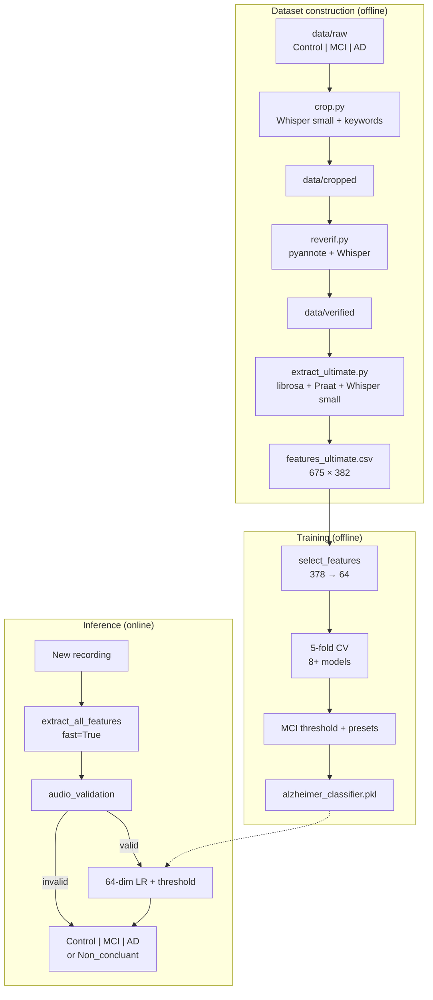

# P2M Alzheimer Voice — Master ML / Model / Dataset Architecture

**Scope:** Machine learning, models, dataset, training tricks, feature engineering, and inference.  
**Not covered in depth:** Flutter UI, FastAPI routes, deployment, git layout.

**Classes:** `Control` (cognitively healthy) · `MCI` (mild cognitive impairment) · `AD` (Alzheimer’s disease)  
**Clinical task:** Spoken **Cookie Theft** picture description (Boston-style narrative).

---

## 1. Executive summary

This project is a **tabular ML classifier on engineered voice + language features**, not an end-to-end deep audio model.

```text
┌─────────────────────────────────────────────────────────────────────────────┐
│  OFFLINE (research / training) — build once                                 │
├─────────────────────────────────────────────────────────────────────────────┤
│  Raw WAVs (3 folders) → crop → reverif → extract_ultimate (Whisper+Praat+…)   │
│       → features_ultimate.csv (675 × 382 cols)                              │
│       → feature selection (378 → 64) → train classifiers → .pkl bundle      │
└─────────────────────────────────────────────────────────────────────────────┘
                                    │
                                    ▼
┌─────────────────────────────────────────────────────────────────────────────┐
│  ONLINE (app / API inference) — per recording                               │
├─────────────────────────────────────────────────────────────────────────────┤
│  One audio → librosa load → extract_all_features(fast=True)                  │
│       → validate_audio_row (quality + Cookie Theft content)                 │
│       → if invalid: Non_concluant                                           │
│       → if valid: 64 selected features → imputer → scaler → LR proba          │
│       → MCI threshold preset → Control / MCI / AD                             │
└─────────────────────────────────────────────────────────────────────────────┘
```

**Core design principle:**  
- **Whisper** and rich text features are used heavily at **extraction** and **validation**, but the **saved classifier** is a **64-dimensional tabular model** (Logistic Regression after model comparison; presets tuned for MCI vs Control recall).

---

## 2. Repository ML layout (what matters for models)

| Path | Role |
|------|------|
| `data/raw/{Control,MCI,AD}/*.wav` | Original labeled recordings (not in git; `.gitignore`) |
| `data/cropped/` | After `ml/pipeline/crop.py` — trim investigator prompts / transitions |
| `data/verified/` | After `ml/pipeline/reverif.py` — diarization, keep patient speech |
| `data/features/features_ultimate.csv` | **Training table** — 675 rows, 382 columns |
| `ml/pipeline/crop.py` | Whisper keyword boundary detection + trim |
| `ml/pipeline/reverif.py` | pyannote diarization + patient segment selection |
| `ml/pipeline/extract_ultimate.py` | **Feature factory** — acoustic + Praat + CT + linguistic |
| `ml/training/train_model.py` | Feature selection + model zoo + CV + export `.pkl` |
| `ml/training/tune_mci_control.py` | Grid search MCI weight × probability threshold → **presets** |
| `ml/inference/predict.py` | Predict from CSV rows using bundle |
| `ml/inference/analyze_audio.py` | Full single-file path: extract → validate → predict |
| `ml/inference/audio_validation.py` | Rule-based **Non_concluant** gates |
| `artifacts/models/alzheimer_classifier.pkl` | **Production model bundle** (joblib) |
| `artifacts/reports/selected_features.csv` | 100 candidates; **64** `selected=True` |
| `artifacts/reports/train_cv_comparison.csv` | 5-fold CV scores per algorithm |
| `artifacts/reports/mci_control_tradeoff.csv` | Full grid for preset tuning |

**Scripts (thin wrappers):** `scripts/crop_audio.py`, `reverif_audio.py`, `extract_ultimate.py`, `train.py`, `tune_mci.py`, `predict.py`, `run_api.py`.

---

## 3. Dataset (what the model was trained on)

### 3.1 Provenance and task

- **Task:** Describe the **Cookie Theft** image aloud (children stealing cookies, mother washing dishes, overflowing sink, stool, etc.).
- **Language:** English transcripts in the CSV (e.g. “two kids trying to reach the cookie jar…”).
- **Labels:** Folder name / `patient_type` = **Control**, **MCI**, or **AD**.
- **Source:** Project-local corpus under `data/raw/` — **not** named in code as ADReSS/Pitt/DementiaBank; filenames look like session clips (`01-2.wav`, `253-1.wav`, `395-1 (1).wav`).

### 3.2 Scale and balance

| Metric | Value |
|--------|------:|
| **Samples (rows)** | **675** |
| **Control** | 230 (34.1%) |
| **MCI** | 142 (21.0%) — **smallest / hardest** |
| **AD** | 303 (44.9%) |
| **Duration (seconds)** | mean ~79 s, median ~61 s, min ~12.6 s, max ~600 s |

### 3.3 Column schema (`features_ultimate.csv`)

| Group | Columns | Count (approx.) |
|-------|---------|----------------:|
| **Metadata** | `sample`, `patient_type`, `duration`, `transcript` | 4 |
| **Engineered features** | Everything else | **378** |
| **Total** | | **382** |

**Metadata is never fed to the classifier** (`DROP_COLS` in training).

### 3.4 Why 378 features exist but the model uses 64

| Layer | Count | Meaning |
|-------|------:|---------|
| Extraction output | **378** | “Measure everything we know how to compute” |
| After `select_features()` | **64** | Subset that survives missing/variance/MI/RF/correlation filters |
| Classifier input | **64** | Only these columns + same `imputer` + `scaler` at inference |

The CSV keeps all 378 so you can **retrain**, **change selection**, or **research** without re-running Whisper/Praat on 675 files.

---

## 4. Audio preprocessing pipeline (before features)

### 4.1 Stage A — `crop.py` (`data/raw` → `data/cropped`)

**Goal:** Remove investigator speech and multi-picture transitions; keep the Cookie Theft description segment.

**Models / tools:**
- **Whisper `small`** — transcribe short windows to detect keyword boundaries.
- **Regex keyword lists** — `INTRO_END_KEYWORDS`, `TRANSITION_KEYWORDS` (e.g. “tell me everything you see”, “move on to the next picture”).

**Logic (simplified):**
1. Load WAV with librosa.
2. Find start/end of patient description using Whisper + pattern matches.
3. Trim with padding (`PADDING = 0.15` s).
4. Reject if shorter than `MIN_DURATION = 10` s.
5. Write cropped WAV to class folder (`Control/`, `MCI/`, `AD/`).

### 4.2 Stage B — `reverif.py` (`data/cropped` → `data/verified`)

**Goal:** Speaker diarization — isolate **patient** speech vs interviewer / other speakers.

**Models / tools:**
- **Whisper `small`** — transcript + keyword checks.
- **pyannote.audio Pipeline** — speaker diarization (Hugging Face token optional via env).
- **Heuristics** — `identify_patient`, `find_patient_boundaries`, trim to patient-dominant regions.

**Outputs:** Cleaner patient-only audio in `data/verified/{control,mci,ad}/`.

### 4.3 Stage C — `extract_ultimate.py` (batch)

**Input:** `data/verified/`  
**Output:** Append rows to `data/features/features_ultimate.csv` (resumable — skips already extracted `sample` names).

---

## 5. Feature extraction architecture (`extract_all_features`)

Single entry point: `extract_all_features(file_path, patient_type=None, fast=False)`.

### 5.1 Signal loading

```text
file → librosa.load(sr=None, mono=False forced later) → y, sr
duration = len(y) / sr
```

### 5.2 Temporal framing (acoustic aggregation)

Audio is split into **overlapping frames**; per-frame descriptors are computed, then **aggregated** across frames with statistics.

| Mode | `frame_sec` | `overlap_sec` | Use |
|------|------------:|--------------:|-----|
| **Full (training CSV)** | 5.0 | 2.5 (50% overlap) | Batch extraction |
| **Fast (API / app)** | 10.0 | 7.5 | Fewer frames, faster |

Frames shorter than 1 s are skipped.

**Aggregation stats per descriptor:** `mean`, `std`, `min`, `max`, `median`, `range` → **6 × N_base** frame-derived columns.

### 5.3 Per-frame acoustic descriptors (`frame_acoustic_features`)

**Library:** librosa (+ pyin for pitch).

| Family | Per-frame scalars | Notes |
|--------|-------------------|--------|
| **MFCC** | `mfcc1` … `mfcc13` | 13 coefficients |
| **Δ MFCC** | `mfcc_d1` … `mfcc_d13` | First delta |
| **Δ² MFCC** | `mfcc_d2_1` … `mfcc_d2_13` | Second delta |
| **Spectral** | `spectral_centroid`, `bandwidth`, `rolloff`, `flatness`, `contrast` | |
| **Energy** | `zcr`, `rms_energy`, `rms_std` | |
| **Pitch (pyin)** | `pitch_mean`, `pitch_std`, `pitch_range`, `voiced_ratio` | F0 on voiced frames |
| **Rhythm proxy** | `speech_rate`, `pause_mean`, `pause_count` | Energy threshold on sub-frames |

**Count:** ~54 base names × 6 stats ≈ **324 frame-aggregate columns**.

### 5.4 Praat features (`extract_praat_features`) — **full batch only**

**Library:** parselmouth (Praat).

| Feature | Description |
|---------|-------------|
| `praat_pitch_mean`, `praat_pitch_std` | Pitch track |
| `praat_jitter_local`, `praat_jitter_rap` | Period perturbation |
| `praat_shimmer_local`, `praat_shimmer_apq3` | Amplitude perturbation |
| `praat_hnr` | Harmonics-to-noise ratio |
| `praat_f1`, `praat_f2` | Formants |
| `praat_voiced_fraction` | Voiced proportion |

**~10 columns.** Skipped when `fast=True` (not in final 64 selected features for deployment).

### 5.5 Whisper ASR (semantic layer)

| Mode | Whisper model | Decode |
|------|---------------|--------|
| **Batch** | `small` (env `WHISPER_MODEL` override) | Full beam search |
| **Fast inference** | `base` default (`WHISPER_MODEL_INFERENCE`) | `beam_size=1`, lighter |

**Outputs:** `transcript` string + `segments` list (`start`, `end`, `text`) for time-aligned Cookie Theft features.

### 5.6 Cookie Theft content features (`extract_cookie_theft_features`)

**18 scene elements** (`COOKIE_ELEMENTS`), each 0/1:  
`boy`, `girl`, `woman`, `cookie`, `jar`, `stool`, `falling`, `water`, `overflow`, `sink`, `dishes`, `window`, `curtains`, `cabinet`, `kitchen`, `outside`, `apron`, `stealing`.

| Feature | Meaning |
|---------|---------|
| `ct_{element}` | Binary mention per element |
| `ct_content_score` | Fraction of elements mentioned (used in **classifier** + **validation**) |
| `ct_action_count`, `ct_action_ratio` | Action verbs vs tokens |
| `ct_spatial_count`, `ct_spatial_ratio` | Spatial language |
| `ct_inference_count`, `ct_inference_ratio` | “seems”, “looks like”, … |
| `ct_element_revisit` | Re-mentions of same element |
| `ct_first_element_time` | Time of first key mention (from segments) |
| `ct_description_switches` | Topic switches between elements |
| `ct_main_elements`, `ct_peripheral_elements` | Main vs peripheral scene parts |

**Fast path:** only `ct_content_score` (via `extract_ct_content_score_only`).

### 5.7 Linguistic features (`extract_linguistic_features`)

| Feature | Meaning |
|---------|---------|
| `total_words`, `unique_words` | Token counts |
| `lexical_diversity` | TTR = unique/total |
| `brunet_index` | Robust vocabulary richness |
| `repetitions` | Repeated word excess |
| `filler_count`, `filler_ratio` | uh, um, like, … |
| `SpeechErr` | Stutter-like repeats |
| `NotRem` | “I don’t remember” patterns |
| `verbTense` | Past/present/future marker mix |
| `mean_word_length` | Avg characters per word |
| `sentence_count`, `words_per_sentence` | Syntax complexity |
| `words_per_minute` | Rate from segment duration |

**Fast path:** minimal subset via `extract_linguistic_minimal` (enough for validation + key columns).

### 5.8 Feature column inventory (designed width)

| Block | ~Columns |
|-------|----------:|
| Frame aggregates (MFCC/spectral/pitch/rhythm) | ~324 |
| Praat | ~10 |
| Cookie Theft (`ct_*`) | ~18 + ~11 derived |
| Linguistic | ~14 |
| **Engineered subtotal** | **~378** |
| + metadata | 4 |

---

## 6. Training pipeline (`train_model.py`)

### 6.1 Input / target

- **X:** all columns except `sample`, `patient_type`, `duration`, `transcript`
- **y:** `patient_type` → LabelEncoder → integers
- **MCI index:** tracked for recall-focused metrics and threshold tuning

### 6.2 Feature selection algorithm (378 → 64)

Executed once on full CSV; result saved to `selected_features.csv` and baked into `.pkl`.

| Step | Parameter | Action |
|------|-----------|--------|
| 1. Missing filter | `MISSING_THRESH = 0.40` | Drop columns with >40% NaN |
| 2. Variance filter | std > 1e-8 | Drop constants |
| 3. Impute + scale | `SimpleImputer(median)`, `RobustScaler` | For selection only |
| 4. Mutual information | `MI_MIN_SCORE = 0.005`, `MI_TOP_N = 100` | Keep informative features |
| 5. Random Forest importance | 400 trees, `class_weight=balanced` | Rank features |
| 6. Cumulative RF mass | `RF_CUMULATIVE = 0.95` | Keep until 95% importance (min 25) |
| 7. Min importance floor | `MIN_RF_IMPORTANCE = 0.001` | Drop negligible |
| 8. Correlation prune | `CORR_THRESH = 0.92` | Drop redundant twin (keep higher RF imp.) |

**Output:** `final` list → typically **64 features** (e.g. `rms_energy_mean`, `speech_rate_median`, `ct_content_score`, `mfcc_d4_std`, …).

### 6.3 Preprocessing for classifier (frozen in bundle)

```text
X_raw[64 cols] → SimpleImputer(median) → RobustScaler → X_proc
```

Same objects saved in `alzheimer_classifier.pkl` for inference.

### 6.4 Model zoo (compared with 5-fold stratified CV)

All models use **class imbalance handling** (see §7).

| Model | Key hyperparameters |
|-------|---------------------|
| **LogisticRegression** | `C=0.5`, `class_weight=balanced` |
| **HistGradientBoosting** | 400 iter, lr=0.06, depth=6, `class_weight=balanced` |
| **GradientBoosting** | 350 trees, depth=4, subsample=0.85 |
| **RandomForest** | 500 trees, depth=12, `class_weight=balanced` |
| **ExtraTrees** | 500 trees, `class_weight=balanced` |
| **SVM_RBF** | `C=5`, `gamma=scale`, `probability=True` |
| **XGBoost** (optional) | 400 trees, reg_alpha/lambda, subsample/colsample |
| **LightGBM** (optional) | 400 trees, 31 leaves, `class_weight=balanced` |

**Selection score (training):**

```text
score = 0.45 × MCI_recall + 0.30 × balanced_accuracy + 0.25 × macro_F1
```

**CV results (from `train_cv_comparison.csv`, 5-fold mean):**

| Model | Accuracy | Bal. acc. | Macro F1 | MCI recall |
|-------|----------|-----------|----------|------------|
| **LogisticRegression** | 0.751 | 0.701 | 0.698 | **0.522** |
| LightGBM | 0.770 | 0.707 | 0.705 | 0.437 |
| XGBoost | 0.759 | 0.696 | 0.695 | 0.438 |
| SVM_RBF | 0.750 | 0.686 | 0.684 | 0.438 |
| GradientBoosting | 0.754 | 0.687 | 0.685 | 0.396 |
| HistGradientBoosting | 0.741 | 0.672 | 0.669 | 0.381 |
| RandomForest | 0.745 | 0.676 | 0.675 | 0.374 |
| ExtraTrees | 0.767 | 0.693 | 0.688 | 0.347 |

**Winner for deployment:** **LogisticRegression** (best MCI recall under the project’s composite score).

**Optional:** `VotingClassifier` soft vote over top-3 CV models (stored as `ensemble_top3` in bundle; primary path uses single best).

### 6.5 MCI probability threshold (within training)

After picking best model, **out-of-fold probabilities** tune a threshold on **MCI class probability**:

- Search `t ∈ [0.22, 0.48]` step 0.02.
- If tuned threshold beats default argmax on composite (MCI recall + macro F1), store as `mci_probability_threshold`; else `None` (argmax).

**Mechanism (`predict_with_threshold`):**

```text
pred = argmax(proba)
if proba[mci] >= threshold: pred = MCI
```

Biases predictions toward MCI when clinical priority is catching early impairment.

### 6.6 Final fit

- **SMOTE** oversampling inside each CV fold (if `imbalanced-learn` installed): `k_neighbors = min(3, min_class_count - 1)`.
- Final model refit on **full** `X_proc`, `y` (with SMOTE on training pipeline).
- Export **`joblib`** bundle.

---

## 7. ML tricks for class imbalance & hard MCI class

| Technique | Where | Purpose |
|-----------|--------|---------|
| **StratifiedKFold (5)** | CV | Preserve class ratios per fold |
| **`class_weight=balanced`** | LR, RF, ET, HGB, SVM, LGBM | Inverse frequency weights |
| **MCI weight boost ×2.5** | `build_models()` sample weights | Extra emphasis on smallest class |
| **SMOTE** | CV folds + final fit | Synthetic minority oversampling |
| **MCI recall as primary metric** | Model selection score | Don’t ignore minority class |
| **MCI probability threshold** | Post-hoc on proba | Increase MCI recall at cost of Control |
| **Preset grid (`tune_mci_control.py`)** | 8 weights × 15 thresholds | Operating points for product |

### 7.1 Presets (`tune_mci_control.py`)

Grid: **MCI class-weight multiplier** ∈ {1.0 … 5.0} × **threshold** ∈ {argmax, 0.20 … 0.44}.

Three presets saved (5-fold OOF metrics):

| Preset | Weight | Threshold | MCI recall | Control recall | Macro F1 |
|--------|--------|-----------|------------|----------------|----------|
| **balanced** | 1.0 | argmax | 0.606 | 0.522 | 0.682 |
| **mci_priority** | 1.0 | **0.42** | **0.676** | 0.461 | 0.676 |
| **control_priority** | 1.0 | argmax | 0.606 | 0.522 | 0.682 |

Each preset = separate **LogisticRegression** + threshold in the bundle (`bundle["presets"]`).

**Tuning objective for `balanced`:** maximize harmonic mean of MCI & Control recall (with macro F1 floor).

---

## 8. Inference architecture

### 8.1 Single-file path (`analyze_wav_file`)

```text
1. librosa.load → duration check (≥ 30 s for analysis path)
2. extract_all_features(path, fast=True)
3. validate_audio_row(row, duration_sec)
      ├─ invalid → build_inconclusive_assessment() → Non_concluant
      └─ valid   → continue
4. load_bundle()  # alzheimer_classifier.pkl
5. predict_from_features(df=[row], preset=balanced|mci_priority|control_priority)
6. Map proba → risk score, biomarkers, Flutter JSON payload
```

### 8.2 Validation layer (`audio_validation.py`) — separate from classifier

**Not a neural model** — rule engine on extracted row + duration.

| Check | Threshold (examples) |
|-------|----------------------|
| Duration | `MIN_DURATION_SEC = 30` |
| Word count | `MIN_WORD_COUNT = 25` |
| Words per minute | `MIN_WORDS_PER_MINUTE = 30` |
| Cookie Theft content | `MIN_CT_CONTENT_SCORE = 0.12` |
| Fillers vs low content | `MAX_FILLER_RATIO_WHEN_LOW_CONTENT = 0.45` |
| Speech rate median | `MIN_SPEECH_RATE_MEDIAN = 0.12` |

Failure → **`Non_concluant`** / `validationStatus: invalid` — **no AD/MCI/Control label**.

### 8.3 Classifier step (`predict_from_features`)

```python
feats = bundle["selected_features"]          # 64 names
X = df[feats]
X = bundle["scaler"].transform(bundle["imputer"].transform(X))
proba = preset_classifier.predict_proba(X)
pred = predict_with_threshold(proba, mci_class_index, mci_threshold)
label = bundle["label_encoder"].inverse_transform(pred)
```

### 8.4 Risk score (post-model heuristic)

Not trained end-to-end; combines class probabilities:

```text
risk_score = clip(0.92×P(AD) + 0.58×P(MCI) + 0.12×P(Control), 0, 1)
risk_level ∈ {Low, Moderate, High} by score bands
```

Biomarkers string list pulls from row features (speech rate, pauses, ct_content_score, …).

### 8.5 Model bundle contents (`alzheimer_classifier.pkl`)

| Key | Content |
|-----|---------|
| `version` | `"1.0"` |
| `model_name` | e.g. `"LogisticRegression"` |
| `label_encoder` | sklearn LabelEncoder |
| `class_names` | `["AD","Control","MCI"]` order may vary |
| `mci_class_index` | Index of MCI in proba columns |
| `mci_probability_threshold` | float or None |
| `selected_features` | list[str] length 64 |
| `imputer` | fitted SimpleImputer |
| `scaler` | fitted RobustScaler |
| `classifier` | fitted estimator |
| `presets` | dict of preset → classifier + threshold + metrics |
| `ensemble_top3` | optional VotingClassifier |
| `feature_selection` | metadata (original_count, mi_min, corr_threshold) |

---

## 9. Fast vs full extraction (train/serve consistency)

| Aspect | Full (CSV training) | Fast (app/API) |
|--------|---------------------|----------------|
| Frame size | 5 s / 2.5 s overlap | 10 s / 7.5 s overlap |
| Praat | Yes | **Skipped** |
| Whisper | `small` | **`base`** + faster decode |
| Cookie Theft | All `ct_*` + linguistic | `ct_content_score` + minimal linguistic |
| Frame acoustics | Full pipeline | Full frame acoustics (same librosa code) |

**Important:** Classifier was trained on **full-batch** features. Fast mode still computes **frame aggregates + minimal text**; imputer handles missing Praat/extra CT columns via median imputation. Selected 64 features are chosen from full extraction distribution.

---

## 10. Reported hold-out style performance (tuned LR, full data refit)

From `classification_report_tuned.txt` (CV with MCI threshold tuning):

| Class | Precision | Recall | F1 | Support |
|-------|-----------|--------|-----|--------:|
| AD | 0.97 | 0.94 | 0.95 | 303 |
| Control | 0.73 | 0.47 | 0.58 | 230 |
| MCI | 0.45 | 0.73 | 0.55 | 142 |
| **Accuracy** | | | **0.74** | 675 |

**Interpretation:** AD is easiest; **MCI ↔ Control confusion** is the main error mode; tuning deliberately **boosts MCI recall** at the expense of Control precision/recall.

---

## 11. End-to-end data flow diagram



---

## 12. What this project is NOT

- **Not** raw waveform CNN/Transformer end-to-end classifier.
- **Not** fine-tuning Whisper for diagnosis (Whisper is ASR + feature/validation only).
- **Not** speaker-independent without retraining if domain shifts (mic, language, task).
- **Not** a certified medical device — research / screening prototype.

---

## 13. Key files quick reference

| Question | Answer |
|----------|--------|
| Training table? | `data/features/features_ultimate.csv` |
| How many samples? | **675** |
| How many raw features? | **378** (+ 4 meta) |
| How many model inputs? | **64** |
| Best CV model? | **LogisticRegression** |
| Model file? | `artifacts/models/alzheimer_classifier.pkl` |
| Feature list? | `artifacts/reports/selected_features.csv` |
| Presets? | `balanced`, `mci_priority`, `control_priority` |
| Single-audio inference? | `ml/inference/analyze_audio.py` |
| Quality gate? | `ml/inference/audio_validation.py` |

---

*Document generated from project source: `ml/config.py`, `ml/pipeline/*`, `ml/training/*`, `ml/inference/*`, and `artifacts/reports/*`.*
